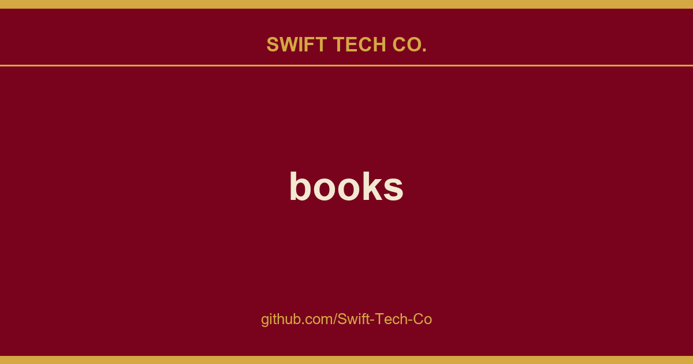

# books

## What This Is

Every project needs a shelf of ready answers. product and engineering is one of those shelves, and books is the entry on it - the notes, patterns and fixes we reuse when this kind of work comes up.

## Images

[](https://github.com/Swift-Tech-Co)

## Frappe Books

Frappe Books is an open-source accounting software aimed at simplifying financial management for businesses. With its clean and user-friendly interface, it streamlines accounting tasks for small and medium-sized enterprises, offering a seamless solution for modern businesses to manage their finances with ease.

<details>
<summary>Screenshots</summary>
<br/>

    <br/><br/>
    
    <br/><br/>
    

</details>

### Motivation

Frappe Books addresses a market gap where small businesses face expensive, complex accounting tools. It offers an intuitive, open-source solution that combines simplicity with essential features, empowering businesses to manage finances effectivelyeven offline.

### Key Features

- **Dashboard**: Provides an overview of key financial data and performance metrics.
- **Point of Sale**: Simplifies retail transactions with an integrated POS system for easy sales processing.
- **Works Offline**: Enables users to continue working without an internet connection and sync later.
- **Double-entry accounting**: Ensures accurate financial tracking by recording each transaction in two accounts.
- **Entries**
  - **Invoicing**: Allows businesses to create and manage professional invoices effortlessly.
  - **Billing**: Billing processes by generating bills and tracking payments.
  - **Payments**: Records and tracks payments received and made.
  - **Journal Entries**: Records financial transactions in the general ledger with detailed notes and adjustments.
- **Financial Reports**
  - **General Ledger**: Centralized record of all financial transactions, providing a comprehensive view of accounts.
  - **Profit and Loss Statement**: Summarizes revenues, costs, and expenses to show business profitability.
  - **Balance Sheet**: Displays a company’s assets, liabilities, and equity at a specific point in time.
  - **Trial Balance**: Verifies the accuracy of accounting records by ensuring that debits and credits are balanced.
    <br/>

### Under the Hood

- **Vue.js**: In Frappe Books, Vue.js powers the front-end, enabling a reactive and component-based UI. It ensures seamless interactions and dynamic updates, giving users a modern, responsive experience.

- **Electron**: Electron is used to package Frappe Books as a standalone desktop application, allowing it to run offline and provide a native-like experience across Windows, macOS, and Linux.

- **SQLite**: Frappe Books uses SQLite as its local database. All financial data, transactions, and configurations are stored securely in an SQLite file on the user's machine.

## Production Setup

### Manual

Download and install the latest release for your platform from the releases
page .

### Using Homebrew (for MacOS and Linux)

```zsh
brew install --cask frappe-books
```

### Via Flatpak (Linux)

<a href='https://www.swifttechco.com'>
    
</a>

## Development Setup

### Pre-requisites

To get the dev environment up and running you need to first set up Node.js `v20.18.1` and npm. For this, we suggest using
nvm.

Next, you will need to install yarn.

### Clone and Run

Once you are through the Pre-requisites, you can run the following commands to
setup Frappe Books for development and building:

```bash


## Want to Just Try Out or Contribute?

If you want to contribute to Frappe Books, please check our Contribution Guidelines. There are many ways you can contribute even if you don't code:

1. If you find any issues, no matter how small (even typos), you can raise an issue to inform us.
2. You can help us with language support by contributing translations.
3. If you're an ardent user you can tell us what you would like to see.
4. If you have accounting requirements, you can become an ardent user. 🙂

If you want to contribute code then you can fork this repo, make changes and raise a PR. (see how to)

## Translation Contributors

| Language              | Contributors                                                                                                                                                                                                                                      |
| --------------------- | ------------------------------------------------------------------------------------------------------------------------------------------------------------------------------------------------------------------------------------------------- |
| Arabic                | taha2002, Faridget, Osama Muhammed                                                                                                                 |
| Albanian              | xoniks                                                                                                                                                                                                               |
| Catalan               | Dídac E. Jiménez                                                                                                                                                                                                                                  |
| Chinese - Simplified  | wcxu21, wolone, Ji Qu                                                                                                                                   |
| Chinese - Traditional | Ethan Deng                                                                                                                                                                                                       |
| Danish                | Tummas Joensen                                                                                                                                                                                                     |
| Dutch                 | RijckAlex, Stan M                                                                                                                                                                      |
| French                | DeepL, mael-chouteau, joandreux                                                                                                                     |
| German                | DeepL, barredterra, promexio, C2H6-383, 0xflotus, Tim |
| Gujarati              | dhruvilxcode, 4silvertooth                                                                                                                                                  |
| Hindi                 | bnsinghgit                                                                                                                                                                                                       |
| Indonesian            | Aji Prakoso                                                                                                                                                                                                         |
| Korean                | Isaac-Kwon                                                                                                                                                                                                       |
| Portuguese            | DeepL, Valdir Amaral                                                                                                                                                                |
| Spanish               | talmax1124, delbertf, Ignacio Chemes                                                                                                          |
| Swedish               | papplo, Crims-on                                                                                                                                                                      |
| Turkish               | Eyuq, XTechnology-TR                                                                                                                                                                                         |

## Learn and connect

- Telegram Group: Used for discussions and decisions regarding everything Frappe Books.
- GitHub Discussions: Used for discussions around a specific topic.
- Documentation: Official documentation for more details.

---

## Swift Tech Co.

Built and maintained by Swift Tech Co.

AI Automation | FinTech Platforms | Custom Software and Mobile Apps | SaaS Platforms | Cloud Infrastructure | Cybersecurity | SEO and Marketing | API Integration

**Join our community on Telegram:** [t.me/+Qt_eFvkb2rliMzNh](https://t.me/+Qt_eFvkb2rliMzNh)

Home | Services | Careers | Referral Program | Influencers | About | Contact

**Connect**

- Website: swifttechco.com
- LinkedIn: [linkedin.com/in/stephenoladoke](https://www.linkedin.com/in/stephenoladoke/)
- LinkedIn (Company): [linkedin.com/company/swift-tech-co](https://www.linkedin.com/company/swift-tech-co)
- X: [@MrOladoke](https://x.com/MrOladoke)
- Instagram: [@mr.oladoke](https://www.instagram.com/mr.oladoke/)
- Instagram (Company): [@swifttechco](https://www.instagram.com/swifttechco/)
- Organization: [github.com/Swift-Tech-Co](https://github.com/Swift-Tech-Co)

## Sources

Compiled and maintained from upstream [programthink/books](https://github.com/programthink/books) under permissive open-source license.

---

Maintained by [Swift Tech Co.](https://github.com/Swift-Tech-Co) - [Telegram](https://t.me/+Qt_eFvkb2rliMzNh)

## Sources

Compiled and maintained from upstream [programthink/books](https://github.com/programthink/books) under permissive open-source license.

---

Maintained by [Swift Tech Co.](https://github.com/Swift-Tech-Co) - [Telegram](https://t.me/+Qt_eFvkb2rliMzNh)